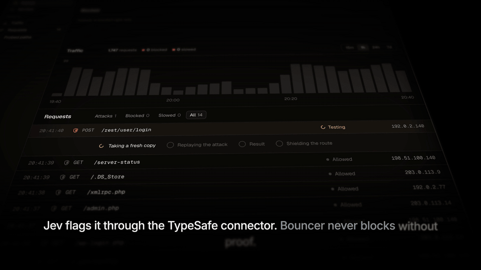

<h1>&nbsp;Bouncer</h1>

Bouncer is a personal security agent for small side projects that can't afford a dedicated Security Engineer. I built it on Fly.io Sprites for the [Fly.io Hacksgiving](https://fly.io/hacksgiving).

It watches every request going to your app. When one looks like an attack, Bouncer sends it again to an isolated copy of the app. If the attack works there, Bouncer blocks the attacker, writes a fix, tests the fix on the copy and opens a pull request for you to review. It never blocks on a guess.

[](VIDEO_URL)

**[Watch the 2-minute demo](VIDEO_URL)**

| Part | Runs on |
|---|---|
| Shop and proxy | Fly.io Sprite `bh-app` |
| Replay server, an isolated copy of the shop with no internet access | Fly.io Sprite `bh-replay` |
| Agent and dashboard | Fly.io Sprite `bh-bouncer` |
| Triage | Jev System One, through the Sprites **TypeSafe** connector |
| Patches and attack versions | Claude, through the Sprites **Anthropic** connector |
| Pull requests | The Sprites **GitHub** connector |

The app in this demo is a fork of [OWASP Juice Shop](https://github.com/aotakeda/juice-shop), a web shop with known security holes.

## Try the live demo

| What | Where |
|---|---|
| Shop (send the attacks here) | https://bh-app-ykmo.sprites.app |
| Dashboard | https://bh-bouncer-ykmo.sprites.app |
| Fix for the login hole | https://github.com/aotakeda/juice-shop/pull/1 |
| Fix for the search hole | https://github.com/aotakeda/juice-shop/pull/2 |

1. Open the dashboard and log in. **The passphrase is in the Hacksgiving submission form**, in the answer to "Is there anything else you'd like the judges to know?".
2. Keep the dashboard open while you run the tests below in order. You only need `curl`.

> **CAUTION:** Blocks and slowdowns apply to your whole IP address. Anyone else on your network gets blocked or slowed down with you.

> **CAUTION:** Tests 2, 3 and 4 send real attacks. Send them only to the demo shop above, never to another site.

The Sprites go to sleep when nobody uses them, so your first request can take around 10 seconds.

### Test 1: Send a scanner request

```bash
curl -s -A 'zgrab/0.x' https://bh-app-ykmo.sprites.app/wp-login.php
```

What you should see:

- The shop returns its normal page.
- The dashboard shows the request as `ignore`, and `/wp-login.php` appears under **Probed paths**. The count doesn't go up for repeats from the same client.
- You are not blocked.

### Test 2: Take the bait, then use it

1. Fetch the fake `.env` file:

   ```bash
   curl -s https://bh-app-ykmo.sprites.app/.env
   ```

2. Put its `ADMIN_EMAIL` and `ADMIN_PASSWORD` values into this command, then run it:

   ```bash
   curl -s -H 'Content-Type: application/json' -d '{"email":"ADMIN_EMAIL","password":"ADMIN_PASSWORD"}' https://bh-app-ykmo.sprites.app/rest/user/login
   ```

What you should see:

- Step 1 returns a fake `.env` file, and the dashboard shows `tarpit`.
- From then on, each of your requests takes 10 seconds, for 10 minutes. That's the slowdown, not an outage.
- Step 2 takes 10 seconds and the shop returns `401`.
- You're blocked right after that. The shop returns `403` for 5 minutes.
- The dashboard shows `block` with the reason "reused honeypot credentials".

To keep going, find your IP address in the dashboard's **Blocked** panel and click **Unblock**. That clears the block, the slowdown and the record that you took the bait.

### Test 3: Dump the users table through product search

```bash
curl -s -A 'sqlmap/1.8' "https://bh-app-ykmo.sprites.app/rest/products/search?q=zz%27%29%29%20UNION%20SELECT%20id%2Cemail%2Cpassword%2C%274%27%2C%275%27%2C%276%27%2C%277%27%2C%278%27%2C%279%27%2C%2710%27%20FROM%20Users--%20demo1"
```

Then open [pull request #2](https://github.com/aotakeda/juice-shop/pull/2) and click **Unblock** on the dashboard.

What you should see:

- The shop returns `200` with user emails and password hashes in `data`, because the fix isn't merged yet. If someone else proved this hole in the last 24 hours, the route is shielded instead and the shop returns `403` with "This route is shielded until its security fix is merged". Both are expected.
- The dashboard shows a high Jev score, then `replay`, then `PROVEN`: the attack leaked test-account values that a harmless control request didn't. A shielded attack is still replayed on the unpatched copy, so you see `PROVEN` either way.
- Within about 10 seconds of the attack you're blocked for 5 minutes.
- The fix links to pull request #2 instead of opening a second one for the same file.
- Pull request #2 shows the patch, the test results from the replay server, and a table of attack versions before and after the patch.

### Test 4: Log in as admin without a password

```bash
curl -s -A 'sqlmap/1.8' -H 'Content-Type: application/json' -d '{"email":"'"'"' or 1=1-- demo1","password":"x"}' https://bh-app-ykmo.sprites.app/rest/user/login
```

Then click **Unblock** on the dashboard.

What you should see:

- The shop returns `200` with an admin login token, or `403` if the route is already shielded.
- The dashboard shows `PROVEN`: the attack solved the Juice Shop "Login Admin" challenge.
- Within about 10 seconds of the attack you're blocked.
- The fix links to [pull request #1](https://github.com/aotakeda/juice-shop/pull/1).

### Running a test again

If you repeat an attack that was already proven from your IP address, Bouncer blocks you right away without replaying it. To see the whole replay again in test 3 or 4, change the text after `--`, for example from `demo1` to `demo2`.

## How it works

1. **Proxy** (`door/`). Every request to the shop goes through the proxy, which logs it with tokens and passwords redacted. The proxy serves a fake `/.env` file as bait, slows down some clients and refuses blocked ones. It slows a client down the moment it takes the bait, and blocks it the moment it reuses the bait, without waiting for the agent. Before checking a request, it undoes the tricks attackers use to hide one: URL encoding, `'`-style escapes, SQL comments, null bytes, and gzip or UTF-16 bodies.
2. **Triage** (`agent/jev.py`). Unusual requests go to the Jev System One model, which scores how malicious they look. The request text is marked as untrusted in the prompt. A request shaped like a known attack (SQL or NoSQL injection, path traversal, script injection, a forged login token) always goes to replay, whatever Jev says.
3. **Replay** (`runner/`). High-scoring requests go to the replay server. It resets the copy and sends the attack next to a harmless control request. The attack counts as real if it leaks a test account's data or solves a Juice Shop challenge.
4. **Decision**. Bouncer blocks an IP address only when it has proof: the attack worked on the replay server, or the same client took the fake `/.env` and then reused its credentials. A block lasts 5 minutes. If a high-scoring attack fails on the replay server, Bouncer only slows the client down for 10 minutes. A suspicious score alone never causes a block.
   - A request sent from inside another site's page (`Sec-Fetch-Site: cross-site`) never gets its sender blocked, even when the attack is proven. The route is still shielded and the attack still shows up on the dashboard. This stops a third-party page from getting its visitors blocked by making their browsers send an attack. Bait values reused this way, or from a client that never took the bait, are only logged.
   - Repeating an attack that was already proven gets an immediate block, without another replay.
   - IPv6 clients are grouped by `/64`, so rotating addresses inside one network doesn't escape a block.
5. **Shield**. When an attack is proven, the proxy shields that route for 24 hours: requests to it that look like an attack get `403` before they reach the shop, whatever their method or path case. Normal requests to the route still work. The agent still replays the refused attack on the unpatched replay server, so the attacker is blocked if it would have worked. Active shields are listed in the dashboard's Blocked panel and on the signal, each with a Remove shield button. Run `./deploy/deploy.sh refresh` after merging a fix to pull it and lift the shields.
6. **Fix** (`agent/fix.py`). For a real attack, Claude writes a small patch for the source file that handles the route, and up to four other versions of the attack. The replay server applies the patch, compiles the code, then sends the original attack, the other versions and some normal requests. Bouncer opens a pull request only if every attack fails and normal requests still behave the same. The pull request says it came from an attacker's request, so review the whole diff, not just the test results.

### Terms

| Term | What it means here |
|---|---|
| Shop | The live Juice Shop that anyone can open. |
| Replay server | The isolated copy of the shop where Bouncer tests attacks and patches. |
| Honeypot | The fake `/.env` file. It contains fake credentials. |
| Canary | A fake value that Bouncer watches for, such as the honeypot credentials or the replay server's test account. |
| Tarpit | A 10-second delay on every request from one IP address. A slowed client gets at most 2 delayed requests at a time; extra parallel requests get `429`. |
| Shield | A route the proxy protects after an attack on it is proven. Attack-shaped requests to it get `403` until the fix is merged. |
| Block | The proxy refuses every request from one IP address with HTTP `403`. |
| Dashboard | The page that shows requests, scores, decisions and fixes as they happen. |

## Run your own copy

You need:

- The `sprite` CLI, installed and logged in.
- Three Sprites named `bh-app`, `bh-replay` and `bh-bouncer`, with `bh-app` labelled `role:app` and `bh-bouncer` labelled `role:bouncer`.
- TypeSafe, Anthropic and GitHub connectors in your Sprites account.
- Python 3. Bouncer uses only the standard library.

Then:

1. Run the tests:

   ```bash
   python3 -m unittest discover -s tests
   ```

2. Optional: add `OWNER_IP=<your public IP>` to `.secrets`. Bouncer never blocks, slows down or shields that address; the dashboard shows what would have happened instead, such as `would_block`. To get real blocks from it, add `-H 'X-Bouncer-Stranger: 1'` to a request, and undo them with `./deploy/deploy.sh unblock owner-as-stranger`.
3. Deploy everything:

   ```bash
   FIX_MODE=pr ./deploy/deploy.sh all
   ```

The script creates `.secrets` if it's missing, installs the shop on two Sprites, links the Sprites, starts the services and locks down network access. It prints the shop and dashboard URLs. The dashboard passphrase is `DASH_PASSPHRASE` in `.secrets`.

> **CAUTION:** `FIX_MODE` defaults to `dry_run`, which tests patches but never opens a pull request. Pass `FIX_MODE=pr` every time you run `deploy.sh services` or `deploy.sh all`.

### Day-to-day commands

| To | Run |
|---|---|
| List blocks, slowdowns and shields | `./deploy/deploy.sh blocks` |
| Remove a block and slowdown (IPv4 address or IPv6 `/64`) | `./deploy/deploy.sh unblock 203.0.113.7` |
| Lift all shields | `./deploy/deploy.sh unshield` |
| Change the dashboard passphrase | Edit `DASH_PASSPHRASE` in `.secrets`, then `FIX_MODE=pr ./deploy/deploy.sh services` |
| Pull merged fixes onto the shop and replay server, then lift the shields | `./deploy/deploy.sh refresh` |
| Change the block length (default 300 seconds) | `BLOCK_SECONDS=600 FIX_MODE=pr ./deploy/deploy.sh services` |

### Limits

- One open pull request per source file at most.
- At most 3 new fix attempts per hour.
- At most 50 slowed requests at once across all clients.
- Fix results live in memory. After a restart, the agent finds its open pull requests again on GitHub.
- Normal `200` and `201` requests skip triage unless they contain attack syntax or scanner headers.
- Shields match the exact path that was attacked, not route patterns like `/api/Users/:id`.

## Protect a different app

These parts already work with any HTTP app:

- The proxy, request log, slowdowns and blocks.
- The honeypot and the check for its fake credentials.
- Jev triage.
- Replaying an attack next to a control request.
- The Claude patch, the attack versions and the pull request.

These parts all assume Juice Shop, so you'd need to change them:

1. **Repository.** Set `GITHUB_REPO` and `GITHUB_BRANCH` for the agent (defaults: `aotakeda/juice-shop` and `master`). `deploy/deploy.sh` doesn't set them yet, so add them to the `--env` list in `deploy_agent`.
2. **App description.** Set `APP_DESCRIPTION` for the agent. Claude and Jev read it, and the default describes Juice Shop.
3. **Route finder.** `agent/route_finder.py` reads `server.ts` and looks for Express routes like `app.get('/path', handler)`. Rewrite it if your app isn't Express and TypeScript.
4. **Install and start.** `deploy/deploy.sh` clones the Juice Shop fork (`FORK`), runs `npm install` and starts `node build/app` on port 3000. Update `install_juice`, `refresh_juice`, `deploy_door` and `deploy_runner`.
5. **Build.** The replay server compiles patches with `RUNNER_BUILD_CMD` (default `./node_modules/.bin/tsc`) into `RUNNER_BUILD_DIR` (default `build`). Point these at your build.
6. **Ready check.** The replay server polls `RUNNER_READY_PATH` (default `/rest/admin/application-version`) to know when the copy is up. Use a path your app has.
7. **Test account.** `plant_canary` in `runner/runner.py` creates the canary account with `POST /api/Users`. Change it to your app's sign-up route.
8. **Normal checks.** `smoke` in `runner/runner.py` sends a Juice Shop search and login. Replace them with normal requests for your app.
9. **Challenge check.** The replay server also reads Juice Shop's `/api/Challenges`. Other apps don't have it, so Bouncer falls back to the canary check alone.
